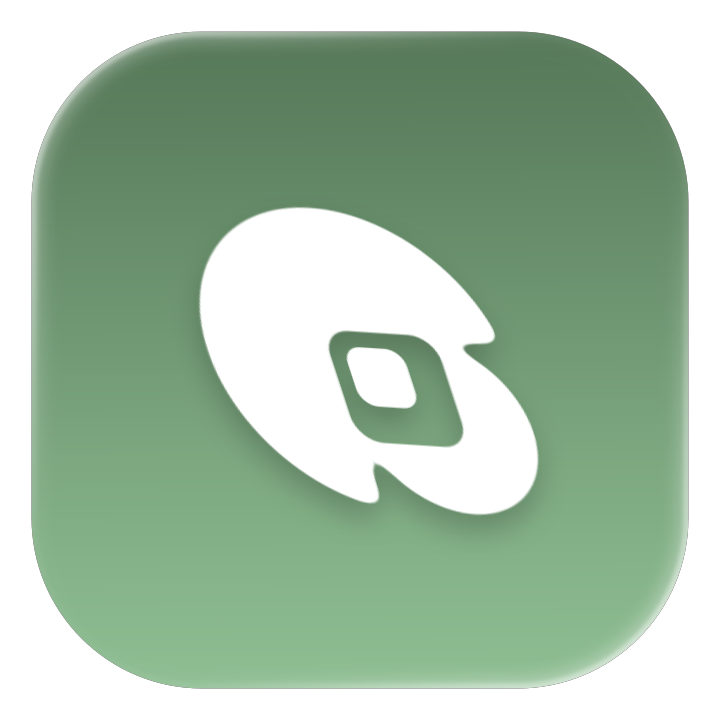

# wristkyion page

I'm a beginner programmer and indie developer from Indonesia, with plenty of ideas and projects I'd love to bring to life. I'm still at the beginning of my journey, learning how to turn my ideas into real, functional applications while exploring new technologies and discovering what I'm capable of creating.

Beyond programming, I'm also interested in various creative fields, including animation, video editing, graphic design, and digital art. I'm not perfect at everything I do, but I believe every skill has room to grow, and every creative experiment is another opportunity to improve.

I'm here to learn, create, experiment, and explore beyond what I already know. Whether it's building software, creating visual content, or trying something completely new, I want to keep developing my skills and turning my ideas into something meaningful.

Still a beginner, but full of ideas. Still learning, but always ready to explore. 🌱

---

  <strong>Programs &amp; Technologies I'm Learning</strong>

  
  
  
  
  
  
  
  
  
  
  
  
  
  
  
  
  
  
  
  
  
  
  
  
  
  
  
  
  

---

  <strong>A collection of things I'm building and experimenting with.</strong>

<table>
  <tr>
    <td width="100" align="center" valign="middle">
      
    </td>
    <td valign="middle">
      
Arca Launcher

      

        A desktop launcher built with Tauri 2, combining modern web
        technologies with native capabilities to create a practical
        desktop experience.
      

    </td>
  </tr>
</table>

  
  
  
    

<table>
  <tr>
    <td width="100" align="center" valign="middle">
      
    </td>
    <td valign="middle">
      
Deq (Dashboard)

      

       Deq is a minimalist, modular, and local-first desktop dashboard designed to
        manage personal records, daily activities, finances, and projects, while bringing
        GitHub activity and commission management into one organized workspace. Built with privacy,
        performance, and simplicity in mind.
      

    </td>
  </tr>
</table>

  
  
  
    

---

  <strong>GitHub Activity</strong>

  

  
  
  

  

